<p align="right"><b>English</b> · <a href="README.zh-CN.md">简体中文</a></p>

# Bourgogne Climat

**An interactive 3D atlas of the vineyards of Burgundy and the Northern Rhône.** Fly over the real terrain, see every
appellation and lieu-dit drawn on the slopes, and read the terroir of any plot: its slope, which way it faces, how much
sun it gets and the rock beneath it.

**Live site:** [climat.daoyizhang.com](https://climat.daoyizhang.com) · Northern Rhône:
[climat.daoyizhang.com/rhone](https://climat.daoyizhang.com/rhone/)

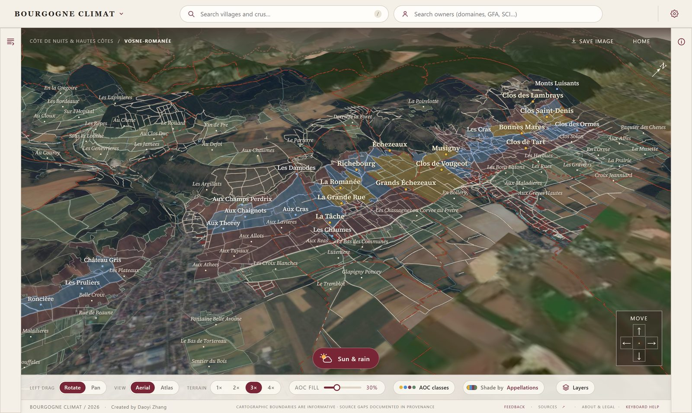

## What you can do

- **Explore in 3D.** 376 communes in Burgundy and 46 in the Northern Rhône, on IGN terrain and aerial photos.
  Rotate, pan and zoom, raise the relief from 1× to 4×, or switch to a printed-map style.
- **See the appellations.** INAO AOC areas coloured by class (grand cru, premier cru, village, regional), lieux-dits
  from the cadastre, commune boundaries, and cadastral parcels when you zoom in.
- **Read a plot's terroir.** Click any lieu-dit or appellation area for its area, elevation range, slope, aspect,
  modelled hours of direct sun and the geology under it.
- **Shade the map by terroir.** Colour the vineyards by slope, aspect, sun hours or geology instead of appellation.
- **Compare two crus.** Put any two crus side by side, even at opposite ends of the Côte: matching same-scale maps
  with contours and parcels, the same maps on the geological map, or one laid over the other; a slope profile from top
  to bottom with the rock underneath; then area, elevation, slope, aspect, sun hours, geology and the largest owners.
  Show both on the 3D map from the best viewing angle, and save the comparison as an image.
- **Guided tour.** A short "How to use" tour on the web and on phones points at each control, with illustrated steps
  for geology shading and comparing.
- **Share exactly what you see.** The address keeps the view, the selected plot, the layers and the comparison, so a
  copied link opens the same map for someone else.
- **Sun & rain.** Watch the sun and shadows move over the hills for any date and time, and see how a storm's rain
  runs off the slopes.
- **Find places and owners.** Search villages and crus, or search the legal entities (domaines, GFA, SCI…) recorded
  as owners in the public DGFiP file, and see which crus they hold parcels in.
- **Use it on a phone.** A touch layout with floating controls, a swipeable info sheet and map-style gestures.

| Plot details | Geology |
|---|---|
| 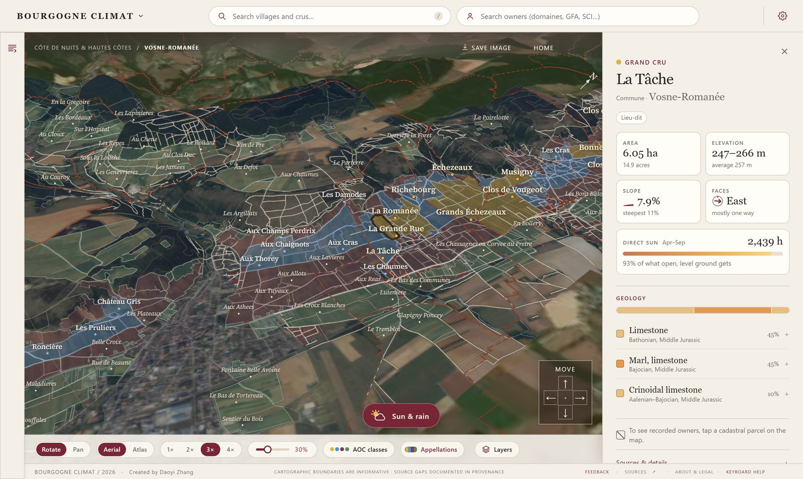 | 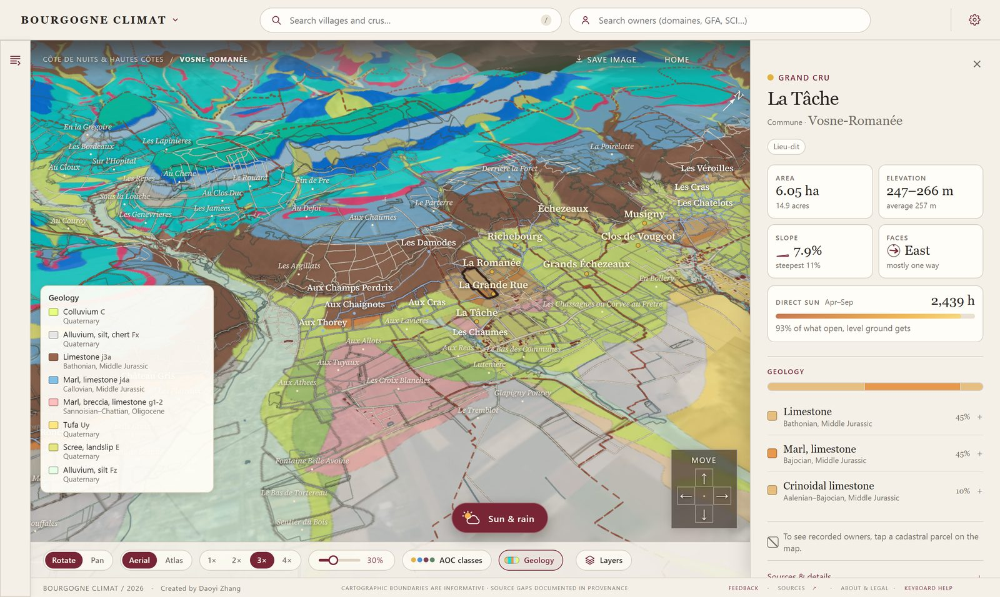 |

| Sun hours | Northern Rhône |
|---|---|
| 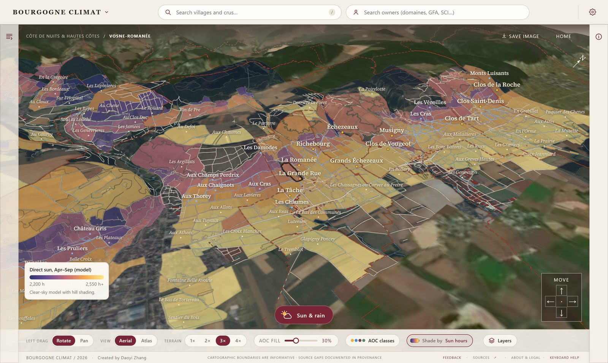 | 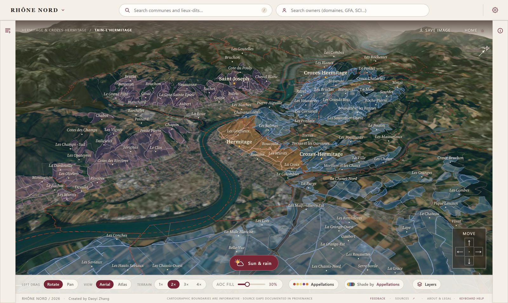 |

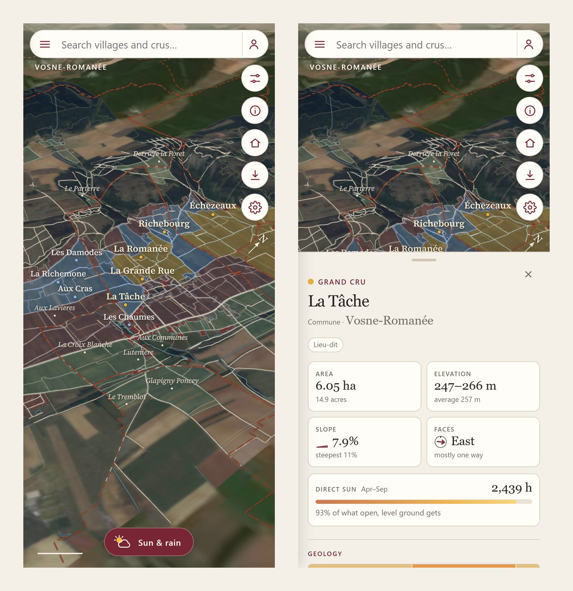

### Compare two crus

Chambertin and Montrachet, at opposite ends of the Côte d'Or. The small maps switch between **Parcels**, **Geology**
and **Overlay**, and **Down the slope** draws both crus from top to bottom with the rock underneath.

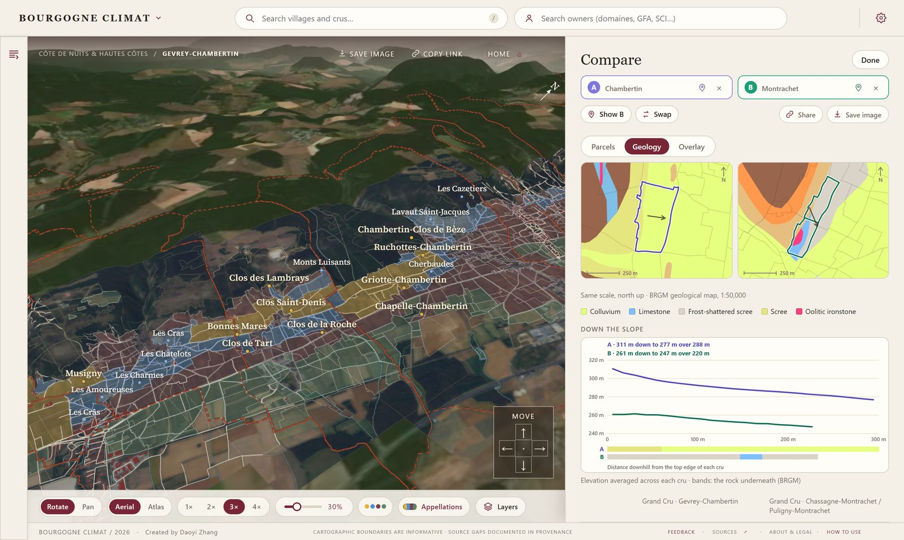

| Overlay and slope profile | Saved comparison image |
|---|---|
| 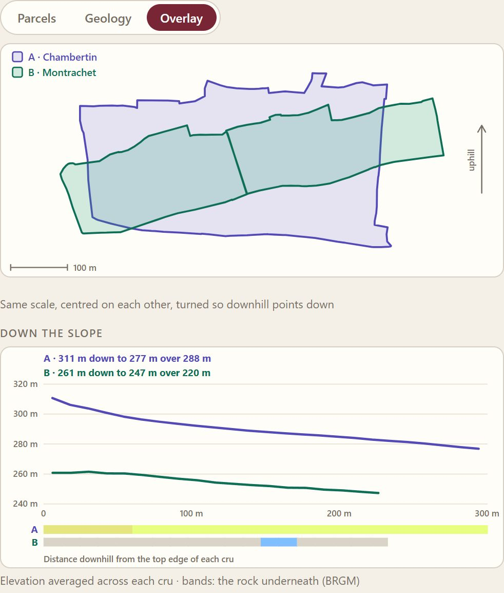 | 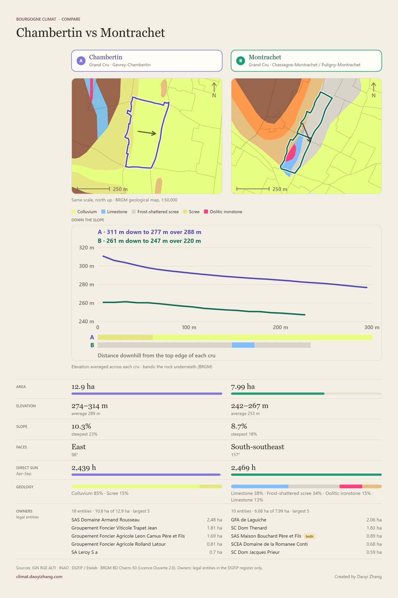 |

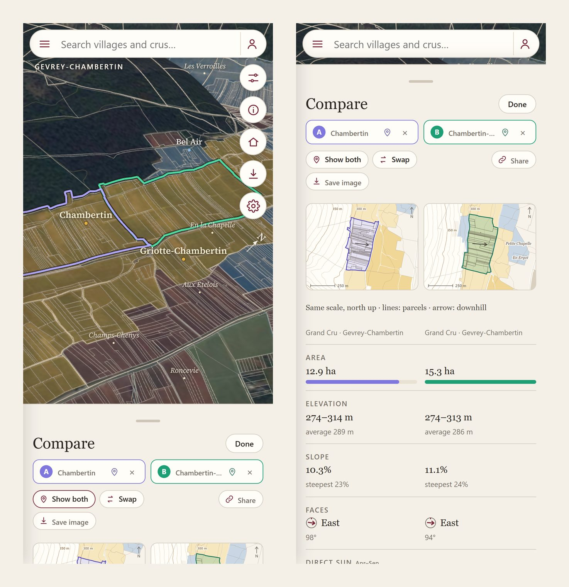

### How to use

A guided tour on the first visit (and from **How to use** at any time) points at each control in turn.

| Web | Phone |
|---|---|
| 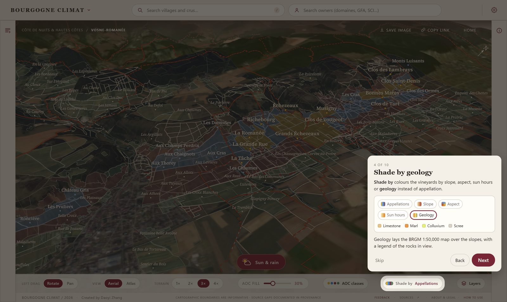 | 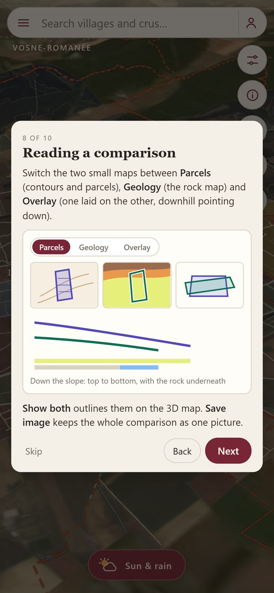 |

## Data sources

All data comes from French public open data under the
[Licence Ouverte / Open Licence 2.0](https://www.etalab.gouv.fr/licence-ouverte-open-licence/), transformed for the
atlas (reprojected, simplified, joined and recoloured).

| Layer | Source |
|---|---|
| AOC boundaries | INAO, [Délimitation parcellaire des AOC viticoles](https://www.data.gouv.fr/datasets/delimitation-parcellaire-des-aoc-viticoles-de-linao) |
| Lieux-dits and cadastral parcels | DGFiP cadastre, distributed by [Cadastre Etalab](https://cadastre.data.gouv.fr/) |
| Parcel owners (legal entities only) | DGFiP, [Fichiers des locaux et des parcelles des personnes morales](https://data.economie.gouv.fr/explore/dataset/fichiers-des-locaux-et-des-parcelles-des-personnes-morales/) |
| Terrain | IGN, RGE ALTI® (1 m and 25 m) |
| Aerial photos | IGN, BD ORTHO® |
| Buildings, roads, water, woodland | IGN, BD TOPO® |
| Geology | BRGM, [BD Charm-50](https://infoterre.brgm.fr/telechargements/BDCharm50/), harmonised 1:50,000 geological maps |

Boundaries are informative and are not a legal survey. Sun hours are a clear-sky model with hill shading, for
comparing places, not a weather record.

## How it works

The atlas is a static site with no build step: plain ES modules and [three.js](https://threejs.org/) render the
terrain, aerial photo and vector layers in WebGL. A small Cloudflare Worker handles only the feedback and correction
forms (D1 database, R2 photo storage, Turnstile). The data is prepared offline by the Python scripts in `scripts/`.

```
dist/        the site: index.html, app.js, atlas-renderer.js, style.css, vendor/ (three.js, fonts)
dist/rhone/  the Northern Rhône page
worker/      Cloudflare Worker for /api/* (feedback and corrections)
scripts/     data preparation and validation (terrain, scenes, terroir, geology, ownership…)
tests/       Node and Python tests
data-templates/  the layout and keys of every data file (the data itself is not in this repository)
```

## Running it

This repository holds the code only. The data payloads under `dist/data/` and `dist/rhone/data/` are not included;
[data-templates/](data-templates/README.md) shows the format of each file, and the scripts in `scripts/` build them
from the public sources above (for example `build_terroir.py` and `build_geology.py`).

With the data in place:

```bash
python scripts/serve.py          # local server for dist/
node --test tests/*.test.mjs     # JavaScript tests
python scripts/validate_site.py  # checks the built data
npx wrangler deploy              # deploy to Cloudflare (needs your own account and wrangler.jsonc settings)
```

For the feedback forms in local development, copy `.dev.vars.example` to `.dev.vars`.
