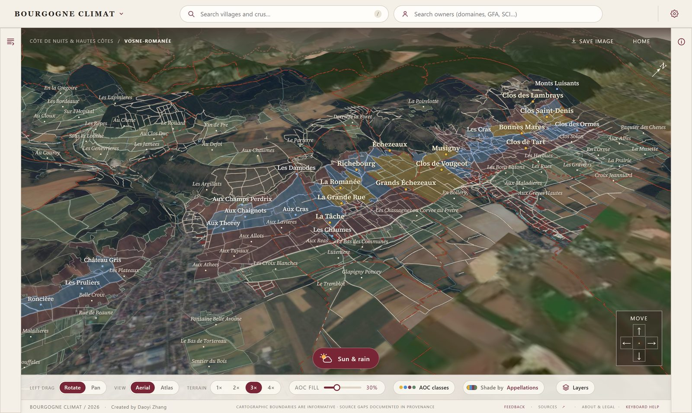
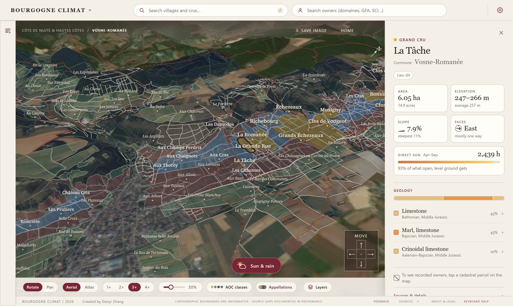
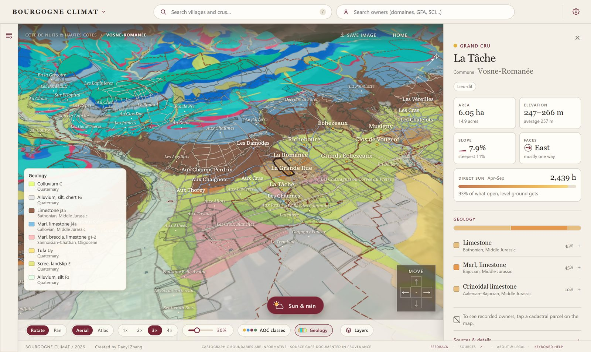
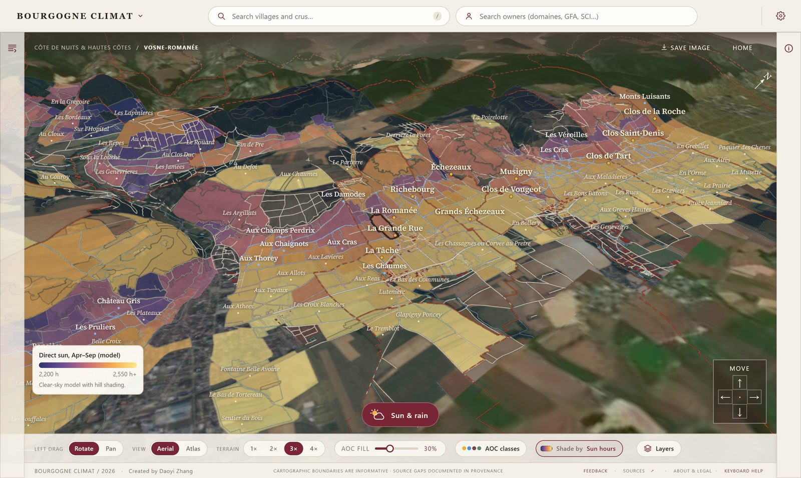
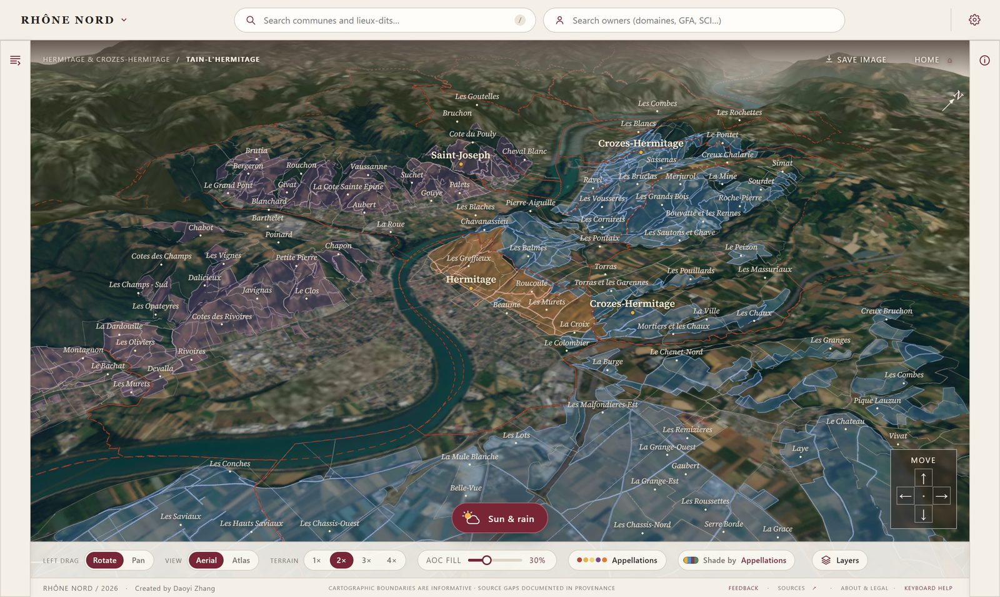
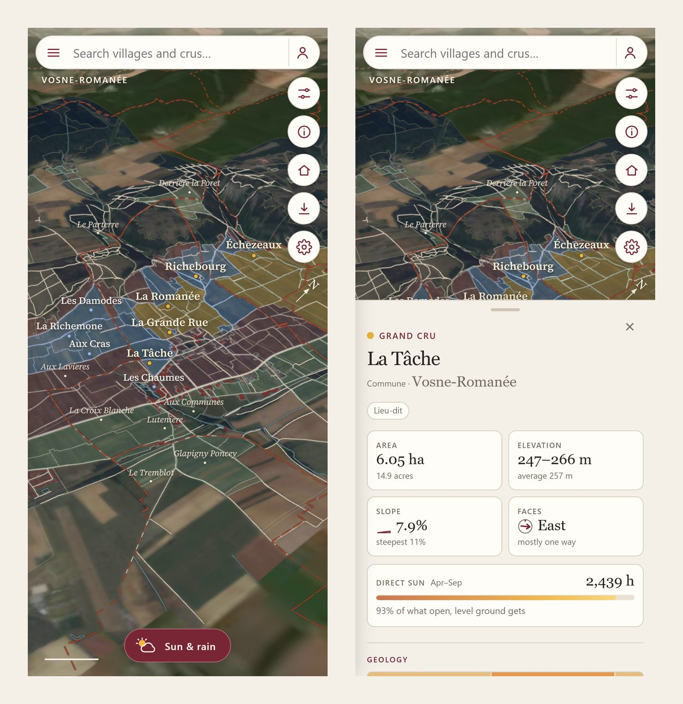

<p align="right"><a href="README.md">English</a> · <b>简体中文</b></p>

# Bourgogne Climat 勃艮第风土地图

**一个勃艮第与北罗讷河谷葡萄园的交互式 3D 地图。** 在真实地形上飞行浏览，在山坡上看到每一个法定产区（AOC）和
lieu-dit（地块名），并查看任意地块的风土：坡度、朝向、日照时长以及下方的岩层。

**在线访问：** [climat.daoyizhang.com](https://climat.daoyizhang.com) · 北罗讷河谷：
[climat.daoyizhang.com/rhone](https://climat.daoyizhang.com/rhone/)



## 功能

- **3D 浏览。** 覆盖勃艮第 376 个市镇和北罗讷河谷 46 个市镇，基于 IGN 地形与航拍影像。
  可旋转、平移、缩放，地形起伏可在 1× 至 4× 之间调节，也可切换为印刷地图风格。
- **查看法定产区。** INAO 的 AOC 范围按等级着色（特级园、一级园、村级、大区级），并显示来自地籍的 lieu-dit、
  市镇边界，以及放大后的地籍地块。
- **查看地块风土。** 点击任一 lieu-dit 或产区范围，可看到面积、海拔范围、坡度、朝向、模拟的直射日照时长和地质。
- **按风土着色。** 可按坡度、朝向、日照时长或地质为葡萄园着色，替代按产区等级着色。
- **日照与降雨。** 选择任意日期和时间，观察太阳与山影在山坡上的移动，以及一场降雨如何沿坡面流走。
- **搜索地点与业主。** 搜索村庄和葡萄园，或搜索 DGFiP 公开文件中登记为业主的法人（酒庄、GFA、SCI 等），
  并查看其在哪些葡萄园拥有地块。
- **手机可用。** 触屏布局：悬浮按钮、可滑动的信息面板，以及与地图应用一致的手势。

| 地块详情 | 地质 |
|---|---|
|  |  |

| 日照时长 | 北罗讷河谷 |
|---|---|
|  |  |



## 数据来源

所有数据均来自法国公共开放数据，遵循
[Licence Ouverte / Open Licence 2.0](https://www.etalab.gouv.fr/licence-ouverte-open-licence/)，
并为本地图做了处理（重投影、简化、合并和重新配色）。

| 图层 | 来源 |
|---|---|
| AOC 边界 | INAO，[Délimitation parcellaire des AOC viticoles](https://www.data.gouv.fr/datasets/delimitation-parcellaire-des-aoc-viticoles-de-linao) |
| Lieu-dit 与地籍地块 | DGFiP 地籍，由 [Cadastre Etalab](https://cadastre.data.gouv.fr/) 发布 |
| 地块业主（仅限法人） | DGFiP，[Fichiers des locaux et des parcelles des personnes morales](https://data.economie.gouv.fr/explore/dataset/fichiers-des-locaux-et-des-parcelles-des-personnes-morales/) |
| 地形 | IGN，RGE ALTI®（1 米与 25 米） |
| 航拍影像 | IGN，BD ORTHO® |
| 建筑、道路、水体、林地 | IGN，BD TOPO® |
| 地质 | BRGM，[BD Charm-50](https://infoterre.brgm.fr/telechargements/BDCharm50/)，统一编制的 1:50,000 地质图 |

边界仅供参考，不具备法律测量效力。日照时长是考虑山体遮挡的晴空模型，用于比较不同地块，并非气象记录。

## 技术实现

本地图是无需构建的静态网站：使用原生 ES 模块和 [three.js](https://threejs.org/) 在 WebGL 中渲染地形、航拍影像和矢量图层。
一个小型 Cloudflare Worker 只负责反馈与纠错表单（D1 数据库、R2 照片存储、Turnstile）。数据由 `scripts/` 中的 Python 脚本离线生成。

```
dist/        网站本体：index.html、app.js、atlas-renderer.js、style.css、vendor/（three.js、字体）
dist/rhone/  北罗讷河谷页面
worker/      处理 /api/* 的 Cloudflare Worker（反馈与纠错）
scripts/     数据准备与校验（地形、场景、风土、地质、业主等）
tests/       Node 与 Python 测试
data-templates/  每个数据文件的结构与字段（数据本身不在本仓库中）
```

## 运行

本仓库只包含代码。`dist/data/` 与 `dist/rhone/data/` 下的数据文件未包含在内；
[data-templates/](data-templates/README.md) 给出了每个文件的格式，`scripts/` 中的脚本可从上述公开来源生成它们
（例如 `build_terroir.py` 和 `build_geology.py`）。

准备好数据后：

```bash
python scripts/serve.py          # 本地预览 dist/
node --test tests/*.test.mjs     # JavaScript 测试
python scripts/validate_site.py  # 校验生成的数据
npx wrangler deploy              # 部署到 Cloudflare（需要你自己的账号和 wrangler.jsonc 配置）
```

如需在本地开发中使用反馈表单，请将 `.dev.vars.example` 复制为 `.dev.vars`。

## 作者

由 Daoyi Zhang 制作。
